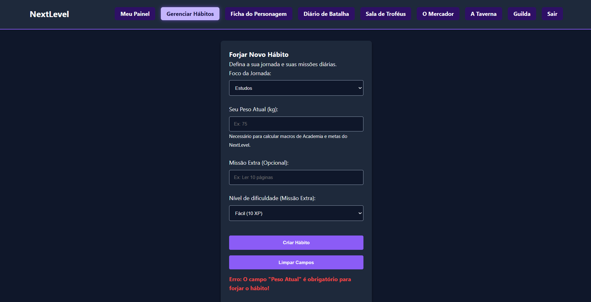
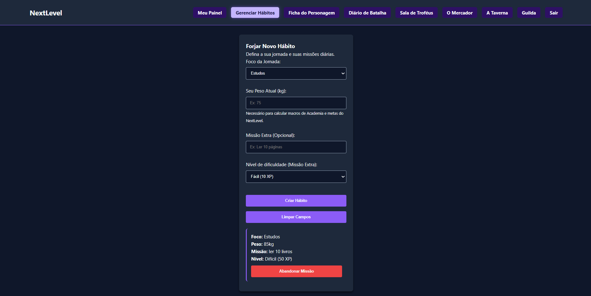
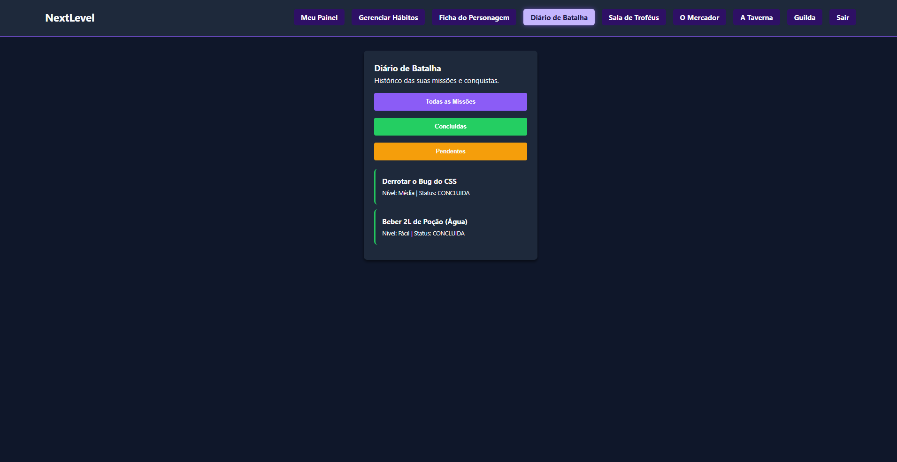
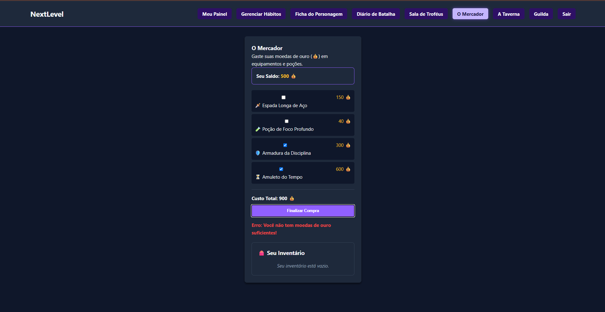
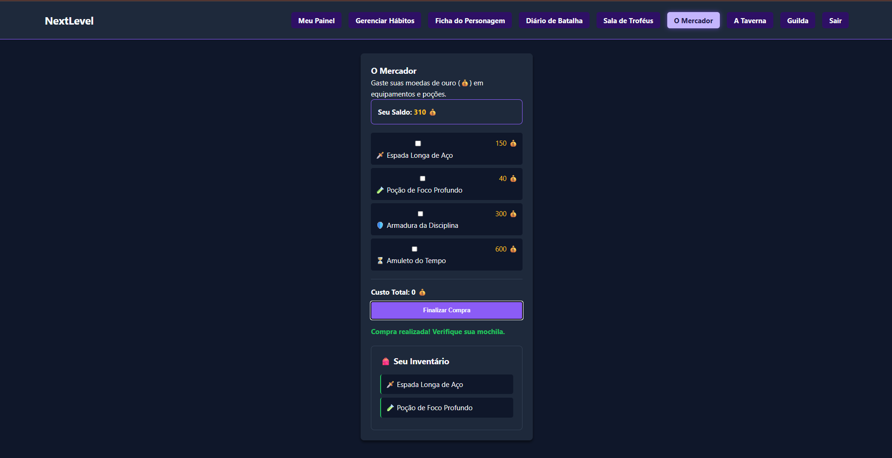

Documentação da Etapa 04 - Interatividade com JavaScriptEste documento detalha as funcionalidades interativas implementadas no projeto NextLevel utilizando JavaScript puro (Vanilla JS), cumprindo os requisitos de manipulação do DOM, tratamento de eventos, validação de formulários, uso de arrays e métodos de iteração.
   1. Funcionalidades Interativas ImplementadasNesta etapa, o projeto recebeu três grandes blocos de interatividade dinâmica para reforçar a temática de "Dark RPG".
   Funcionalidade A: A Forja de Hábitos (Criação Dinâmica)
   Como funciona: O utilizador preenche um formulário para definir um novo hábito ou missão. O sistema valida os dados e, caso estejam corretos, constrói e acopla um novo "card" de missão diretamente na interface, acompanhado de um botão que permite "Abandonar Missão" (remover o elemento).

   Arquivos envolvidos: habitos.html e habitos.js

   Conceitos utilizados: Seleção de elementos (querySelector), Tratamento de eventos (addEventListener('submit')), Prevenção de comportamento padrão (preventDefault()), Manipulação do DOM (createElement, appendChild, remove).
   
   Funcionalidade B: O Pergaminho de Batalha (Filtragem de Missões)
   Como funciona: Uma lista de missões passadas é exibida. O utilizador pode clicar nos botões "Concluídas", "Pendentes" ou "Todas as Missões" para que a interface se redesenhe instantaneamente, exibindo apenas os itens correspondentes ao filtro.

   Arquivos envolvidos: diario.html e diario.js
   
   Conceitos utilizados: Estrutura de dados com Arrays de Objetos JSON, Métodos declarativos de iteração (forEach, filter), Manipulação do DOM (replaceChildren(), innerHTML), Arrow Functions.
   
   Funcionalidade C: O Mercador (Loja, Cálculo e Inventário)
   
   Como funciona: A vitrine da loja é renderizada dinamicamente a partir de um Array de produtos. Ao selecionar equipamentos, o sistema calcula o valor total da compra em tempo real. Ao submeter o formulário, o sistema valida se o utilizador possui "ouro" suficiente, deduz o saldo e transfere visualmente os itens comprados (com os respetivos emojis) para uma aba separada de "Inventário".
   
   Arquivos envolvidos: loja.html e loja.js
   
   Conceitos utilizados: Pipeline de dados, Métodos de agregação (reduce), Alteração de Estado (let saldoAtual), Tratamento de eventos (change e submit), Atributos de dados (data-icone, data-nome).
   
   2. Validações e Situações Inválidas Tratadas
   
   Para garantir a estabilidade da aplicação, as seguintes situações inválidas foram tratadas sem o uso de alertas intrusivos (mensagens renderizadas diretamente no DOM)
   
    Forja de Hábitos (Campos Vazios): O sistema utiliza igualdade estrita (===) para impedir a criação de um hábito se o campo "Peso Atual" estiver vazio.
    
    Forja de Hábitos (Valores Negativos/Zerados): O sistema converte a entrada para número (Number()) e bloqueia envios com peso <= 0, exibindo uma mensagem de erro em vermelho.
    
    O Mercador (Compra Vazia): Tentativas de clicar em "Finalizar Compra" com o valor total em 0 (sem itens selecionados) disparam um aviso amarelo orientando a seleção de um equipamento.
    
    O Mercador (Saldo Insuficiente): Se o total calculado pelo .reduce() ultrapassar o saldoAtual, a compra é bloqueada preventivamente e uma mensagem de erro alerta que faltam moedas de ouro.

    3. Matriz de Evidências
    Abaixo encontra-se a correlação entre os requisitos exigidos para a Etapa 04 e a sua respectiva implementação:

====================================================
MATRIZ DE EVIDÊNCIAS - ETAPA 04
====================================================

REQUISITO: Manipulação do DOM
FUNCIONALIDADE: Criação de hábitos e Renderização da loja
ARQUIVO(S): habitos.js, loja.js
EVIDÊNCIA: Uso de document.createElement('li') e appendChild() para inserir novos elementos na lista visível[cite: 85].
----------------------------------------------------

REQUISITO: Tratamento de eventos
FUNCIONALIDADE: Interações de clique, mudança e formulários
ARQUIVO(S): habitos.js, diario.js, loja.js
EVIDÊNCIA: Funções atreladas a addEventListener('submit') nos formulários, 'click' nos botões de filtro e remover, e 'change' nos checkboxes[cite: 85].
---------------------------------------------------

REQUISITO: Validação de formulários
FUNCIONALIDADE: A Forja de Hábitos e O Mercador
ARQUIVO(S): habitos.js, loja.js
EVIDÊNCIA: Estruturas de decisão (if) bloqueando o envio e injetando mensagemErro.textContent caso as regras de negócio falhem[cite: 85].
----------------------------------------------------

REQUISITO: Alteração dinâmica da interface
FUNCIONALIDADE: O Mercador e Diário de Batalha
ARQUIVO(S): loja.js, diario.js
EVIDÊNCIA: Atualização do displaySaldo.textContent após a compra, transferência visual de itens para a lista "Inventário", redesenho da lista filtrada no diário[cite: 85].
----------------------------------------------------

REQUISITO: Uso de funções
FUNCIONALIDADE: Lógica encapsulada e modular
ARQUIVO(S): diario.js, loja.js
EVIDÊNCIA: Criação de funções dedicadas como renderizarLoja() e renderizarMissoes(), além do uso extensivo de Arrow Functions nos callbacks[cite: 85].
----------------------------------------------------

REQUISITO: Uso de arrays
FUNCIONALIDADE: Estruturação de dados de estado
ARQUIVO(S): diario.js, loja.js
EVIDÊNCIA: Definição das variáveis 'missoes' e 'produtos' contendo Arrays de Objetos JSON. Captura de nós usando Array.from()[cite: 85].
----------------------------------------------------

REQUISITO: Métodos de iteração
FUNCIONALIDADE: Filtros, renderização de listas e cálculos financeiros
ARQUIVO(S): diario.js, loja.js
EVIDÊNCIA: Uso de .forEach() para popular o DOM, .filter() para separar as abas do diário e .reduce() para somar o custo total dos itens marcados no mercador[cite: 85].
----------------------------------------------------

REQUISITO: Tratamento de situações inválidas
FUNCIONALIDADE: Bloqueio de ações falhas do utilizador
ARQUIVO(S): habitos.js, loja.js
EVIDÊNCIA: Verificação de "custoTotal > saldoAtual" e "pesoValue === ''" gerando feedback dinâmico na interface e usando "return;" para abortar a função preventivamente[cite: 85].

====================================================
## 5. Evidências do Funcionamento

**1. Forja de Hábitos (Validação de campo vazio e Criação com sucesso):**

**2. Diário de Batalha (Filtro Dinâmico):**

**3. O Mercador (Erro de Saldo e Compra para o Inventário):**

